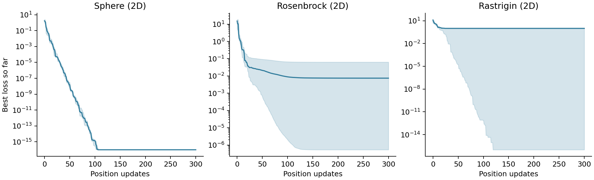

# Particle swarm optimization

How do a swarm's update rule and random initialization affect its search for an optimum? This repository contains the course implementation and a separate NumPy experiment on Sphere, Rosenbrock and Rastrigin functions.

The ten-seed experiment converges consistently on the two-dimensional Sphere function. Rosenbrock and Rastrigin show a wider spread of outcomes, making seed sensitivity visible instead of reporting only the best run.

[Coursework notebook](FuzzySystems-EvolutionaryComputing-Project.ipynb) · [Experimental implementation](pso_implementation.py) · [Assignment context](docs/assignment-context.md)

## Two update rules

Particles use their own best position, sampled neighbours and the swarm-wide best to update their velocity and position.

The **coursework implementation** follows the assignment's explicit `candidate - best` equation and required `softpy` interfaces. Its saved Sphere example reports fitness −1.508873 after 10,000 iterations.

The **separate experiment** uses the usual attractive direction, `best - position`. It also changes initialization, boundary handling and final-population evaluation. These changes define a different algorithm and interface; its results are not a correction or a direct benchmark comparison of the submission. [The update rule](docs/variant.md) includes a complete usage example.

## Ten-seed results



Each run uses 15 particles, three sampled neighbours, 300 updates and bounds `[−5.12, 5.12]` in both dimensions. Seeds are 0–9.

| Function | Median final loss | Best | Worst |
| :--- | ---: | ---: | ---: |
| Sphere, 2D | 1.86e−43 | 3.97e−44 | 8.79e−43 |
| Rosenbrock, 2D | 0.00747 | 0.00000 | 0.62592 |
| Rastrigin, 2D | 0.99496 | 0.00000 | 0.99496 |

Sphere's smooth landscape is solved reliably in these runs. The results on the curved Rosenbrock valley and multimodal Rastrigin surface depend more on the seed. The plot clips losses below `1e-16` for display; [raw results](results/benchmark.json) retain the values.

## Contribution

**Matteo Pietro Di Pilato** · Fuzzy Systems and Evolutionary Computing, BSc in Artificial Intelligence. The repository includes the assignment implementation and the later standalone variant, benchmark and checks.

## Limits and next steps

These small two-dimensional experiments characterize one configuration. They do not establish superiority over other optimizers or isolate the effect of reversing the velocity direction. A controlled follow-up would vary one design choice at a time and compare against a standard PSO implementation at the same objective-evaluation budget.

## Run the experiment

```bash
git clone https://github.com/pdmdp/ParticleSwarmOptimizationProject.git
cd ParticleSwarmOptimizationProject
python -m pip install -r requirements.txt
python -m unittest discover -s tests -v
python benchmark.py
```

The interface maximizes fitness: negate a loss to minimize it. Six tests cover the update and convergence behaviour, bounds, final-step evaluation, repeated fits, single-particle behaviour and invalid inputs. The original notebook uses `requirements-original.txt`.

Code: [MIT](LICENSE).
